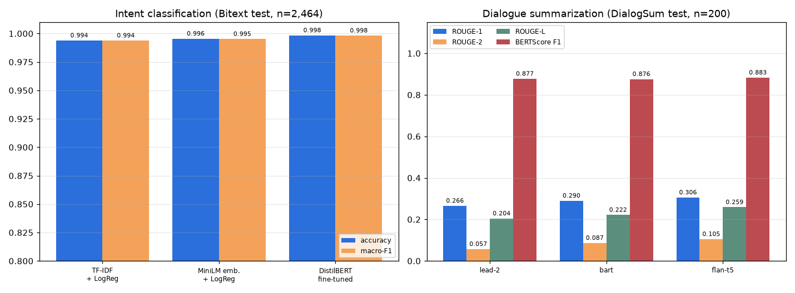
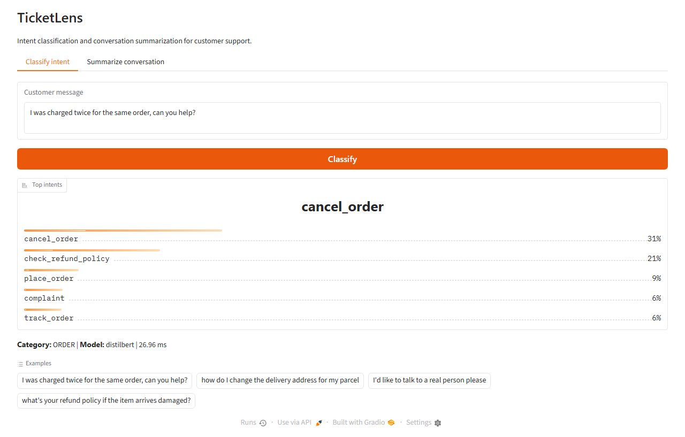
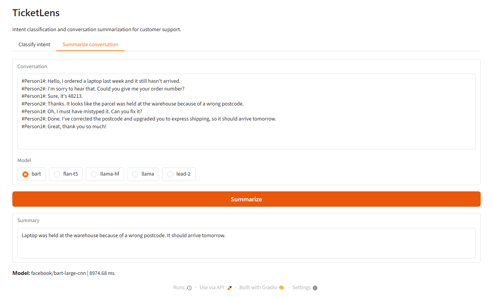
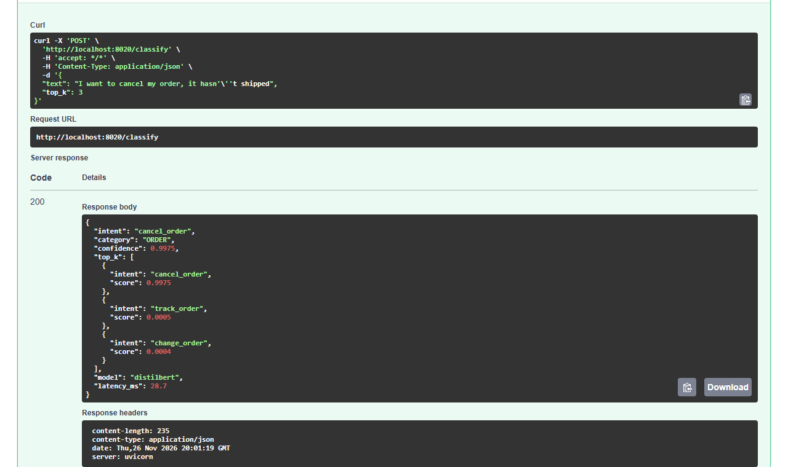
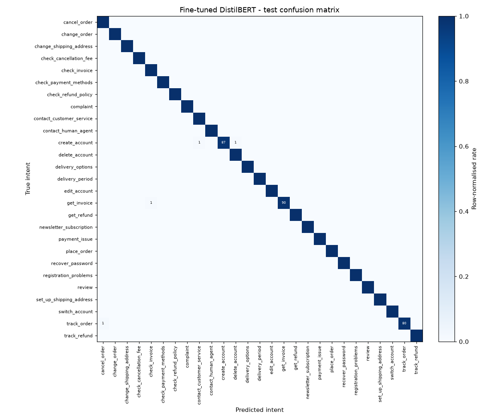
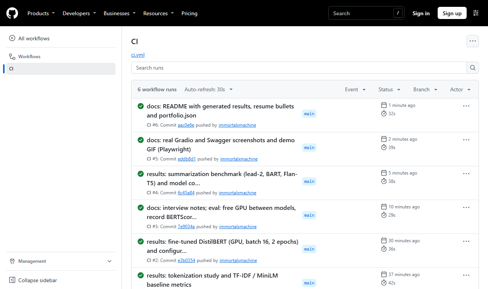
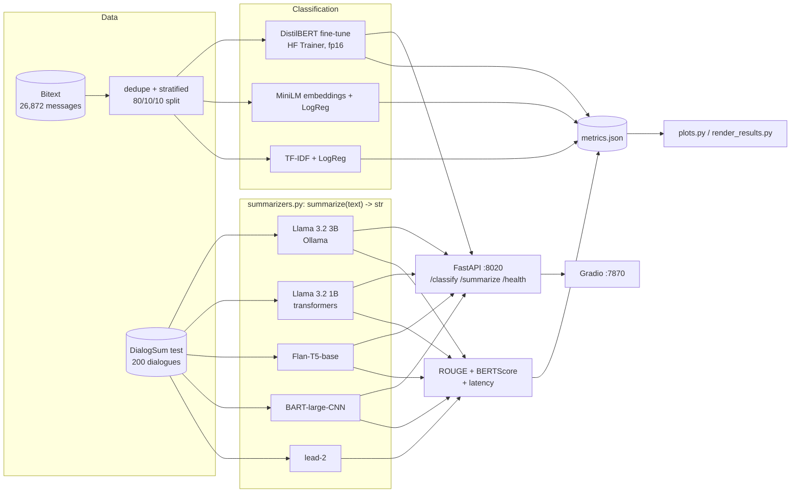

# TicketLens: support-ticket intent classification and conversation summarization

[](https://github.com/immortalxmachine/ticketlens/actions/workflows/ci.yml)


TicketLens is an NLP benchmark for two jobs a customer-support team does all day:

1. **Route a ticket**: classify a customer message into one of 27 intents. Three approaches are compared:
   TF-IDF + logistic regression, frozen MiniLM sentence embeddings + logistic regression, and a **fine-tuned DistilBERT**.
2. **Summarize a conversation** for the next agent. A lead-2 baseline, **BART**, **Flan-T5** and a **Llama 3.2** instruct
   model share one interface. They are scored with **ROUGE** and **BERTScore** on DialogSum.

The best models are served by a **FastAPI** service with a **Gradio** demo. Every number below is read from
[`metrics.json`](metrics.json), which only the code writes.

## Results

**Intent classification**: Bitext, 27 intents, stratified split train 19,707 / val 2,464 / test 2,464 (seed 42).

| Model | Accuracy | Macro-F1 | Notes |
|---|---|---|---|
| TF-IDF (1-2 grams) + LogReg | 0.9939 | 0.9938 | 4,977 features, trained in 3.51 s (CPU) |
| all-MiniLM-L6-v2 embeddings + LogReg | 0.9955 | 0.9952 | 384-d embeddings, frozen encoder |
| distilbert-base-uncased fine-tuned | **0.9984** | **0.9982** | 2 epochs, max_length 24, batch 16, 171.7 s on an RTX 4060 Laptop GPU |

**Dialogue summarization**: DialogSum test subset, n = 200 dialogues (seed 42), zero-shot.
BERTScore uses `roberta-large` (layer 17).

| Model | ROUGE-1 | ROUGE-2 | ROUGE-L | BERTScore F1 | Avg latency (s) | Avg words |
|---|---|---|---|---|---|---|
| lead-2 (first two turns, no model) | 0.2656 | 0.0573 | 0.2044 | 0.8773 | 0.000 | 25.7 |
| `facebook/bart-large-cnn` | 0.2900 | 0.0867 | 0.2217 | 0.8758 | 1.718 | 30.7 |
| `google/flan-t5-base` | **0.3056** | **0.1051** | **0.2589** | **0.8828** | 1.454 | 13.6 |
| `unsloth/Llama-3.2-1B-Instruct` (transformers) | not run | | | | | |
| `llama3.2:3b` (Ollama) | not run | | | | | |

Latency is per dialogue at batch size 1 on the RTX 4060 Laptop GPU, after one warm-up call.



### What the numbers say

- **The classification data is easy.** Bitext is hybrid-synthetic: it was generated from seed templates. All three
  models are above 99%. The 1 MB TF-IDF model is within 0.5 points of DistilBERT and runs in milliseconds on a CPU.
  For this data it is a reasonable production choice; DistilBERT is the stronger fallback for messier real text.
- **The domain matters more than model size for summaries.** BART-large-CNN was fine-tuned on news, where the first
  sentences make a good summary. On dialogues it often copies the opening turns, so it barely beats lead-2, and its
  BERTScore is slightly below it. The smaller Flan-T5-base was instruction-tuned, so it rewrites the content. It gives
  the shortest outputs and the best score on every metric.
- **BERTScore separates the models less than ROUGE does** (0.876 to 0.883). Read it alongside ROUGE and the side-by-side
  examples in [`reports/summarization_examples.md`](reports/summarization_examples.md).
- **Llama was not run.** Ollama was not installed on the build machine. Llama-3.2-1B through transformers failed to load
  because the laptop ran out of Windows paging-file memory. Both back-ends are implemented and selectable; they have no
  measured numbers, so none are shown.

## Screenshots

| | |
|---|---|
|  |  |
| **Classify:** top-5 intents from fine-tuned DistilBERT. This phrasing ("charged twice") is unlike the training templates, so confidence is low (31%) and the top intent is wrong. A real system would send this to a human. | **Summarize:** BART-large-CNN on a support dialogue, served by the API |
|  |  |
| **API:** Swagger `/docs` with a real `POST /classify` response | **Confusion matrix:** fine-tuned DistilBERT on the 2,464-message test set |
|  |  |
| **Model comparison:** chart drawn from `metrics.json` by `ticketlens/plots.py` | **CI:** GitHub Actions running ruff and pytest on every push |

The app images are real captures of this code running locally, made with Playwright (`scripts/capture_screenshots.py`); the CI image is a Playwright capture of this repository's public Actions page.
The GIF is converted from the recorded video by `scripts/make_gif.py` (ffmpeg, two-pass palette).

## Architecture



| File | What it does |
|---|---|
| `ticketlens/data.py` | Loads Bitext and DialogSum from the Hugging Face Hub, removes duplicates and splits with stratification |
| `ticketlens/tokenization.py` | Compares WordPiece and whitespace tokens and picks `max_length` from the train-split lengths (p99 = 22, so 24) |
| `ticketlens/classify_baselines.py` | TF-IDF + LogReg and MiniLM embeddings + LogReg, with confusion matrices |
| `ticketlens/classify_distilbert.py` | Fine-tunes DistilBERT with `Trainer`, dynamic padding and best-checkpoint-by-macro-F1 |
| `ticketlens/summarizers.py` | One `summarize(text)` interface for lead-2, BART, Flan-T5, Llama via transformers, and Llama via Ollama |
| `ticketlens/eval_summarization.py` | ROUGE, BERTScore and latency on a fixed DialogSum subset; saves every output to `reports/summaries/` |
| `ticketlens/api.py` / `demo.py` | FastAPI service and Gradio UI |
| `ticketlens/metrics_io.py` | The only writer of `metrics.json` |
| `scripts/` | `run_all.sh` (whole pipeline), `render_results.py` (README tables), screenshot and GIF capture |

## Run it

```bash
python -m venv .venv && source .venv/Scripts/activate        # Windows Git Bash; use bin/activate on Linux/macOS
pip install torch --index-url https://download.pytorch.org/whl/cu126   # or .../whl/cpu
pip install -r requirements.txt
source scripts/env.sh          # optional: keeps the HF cache, pip cache and temp files inside the repo (.cache/)

bash scripts/run_all.sh        # tokenization -> baselines -> DistilBERT -> summarizers -> chart
python scripts/render_results.py   # prints the results tables from metrics.json

uvicorn ticketlens.api:app --port 8020   # API, Swagger UI at http://localhost:8020/docs
python -m ticketlens.demo                # Gradio at http://localhost:7870
```

Optional Llama via Ollama: `ollama pull llama3.2:3b`, then
`python -m ticketlens.eval_summarization --models llama`.

```bash
curl -X POST localhost:8020/classify -H "content-type: application/json" \
     -d '{"text": "I want to cancel my order", "top_k": 3}'
curl -X POST localhost:8020/summarize -H "content-type: application/json" \
     -d '{"text": "#Person1#: My parcel never arrived.\n#Person2#: I will resend it today.", "model": "flan-t5"}'
```

**Docker** (`Dockerfile`, `docker-compose.yml`: API on 8020, Gradio on 7870, CPU torch, `./models` mounted):
written but **not verified**, because Docker was not available on the build machine.

## Tests and CI

`pytest` runs 17 tests with no model downloads. The heavy classifier and summarizers are replaced with fakes in the API
tests. TF-IDF, lead-2, ROUGE, splitting and metrics merging are tested with the real code. GitHub Actions runs
`ruff check` and `pytest` with a lightweight dependency set that has no torch (`requirements-ci.txt`).

## Limitations

- Bitext is hybrid-synthetic, so the classification scores are higher than you would see on real tickets.
- Summarization is zero-shot on 200 dialogues. DialogSum is everyday dialogue, not support tickets specifically.
- ROUGE and BERTScore measure overlap with one human reference, not factual correctness.
- The Llama rows were not run, and Docker is not verified (see above).

More detail is in [INTERVIEW_NOTES.md](INTERVIEW_NOTES.md).

## Data and licenses

- [Bitext customer support](https://huggingface.co/datasets/bitext/Bitext-customer-support-llm-chatbot-training-dataset): CDLA-Sharing-1.0
- [DialogSum](https://huggingface.co/datasets/knkarthick/dialogsum) (Chen et al., 2021): CC BY-NC-SA 4.0, non-commercial use

The data is downloaded at run time and is not committed. Model licenses are in [`data/SOURCES.md`](data/SOURCES.md).
